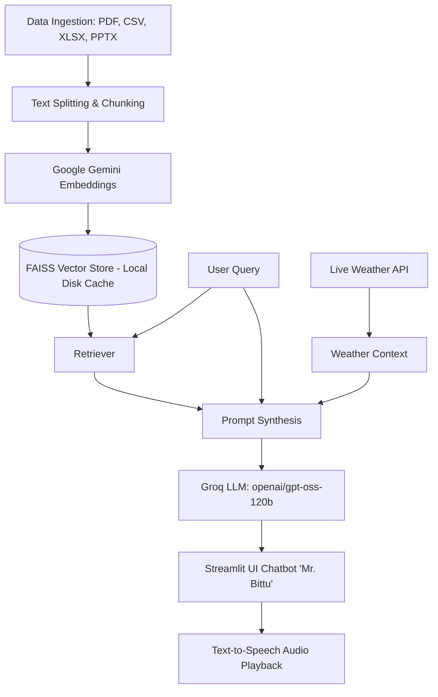

# Real-Time Personalized Health Advisory System

An intelligent, multi-modal Retrieval-Augmented Generation (RAG) health advisory application powered by **LangChain**, **FAISS**, **Groq LLMs**, **Google Gemini**, and **Streamlit**.

The system dynamically contextualizes medical document retrieval with **live real-time weather conditions** to provide personalized, actionable wellness and health advice with voice support and medical report analysis.

---

## 🌟 Key Features

- **Context-Aware Health Advice**: Ingests health and medical literature to answer user health, wellness, and fitness inquiries accurately.
- **Real-Time Weather Integration**: Queries the OpenWeather API for real-time weather metrics (temperature, humidity, air pressure, wind speed) to adapt advice (e.g., heat-related hydration advice, weather-appropriate workouts).
- **Multi-Format Document Ingestion**:
  - **PDFs**: Research papers on nutraceuticals, dietary supplements, and contraindications.
  - **CSVs**: Comprehensive health indicator datasets (diabetes indicators, sleep and lifestyle statistics).
  - **Excel (XLSX)**: Health metrics data records.
  - **PowerPoint (PPTX)**: Presentation slides on general wellness and fitness habits.
- **High-Performance Semantic Retrieval**: Employs Google's Gemini embeddings with a locally persisted **FAISS** vector store for sub-second retrieval.
- **Ultra-Fast LLM Inference**: Powered by Groq-accelerated models (`openai/gpt-oss-120b`) for conversational responses.
- **Text-to-Speech (TTS)**: Built-in audio playback for spoken advice using `gTTS`.
- **Specialized Multi-Page Modules**:
  - 🔬 **Health Report Analyzer (`pages/ChatWithReports.py`)**: Upload diagnostic PDF reports to extract key clinical insights and explanations.
  - 📷 **Image Health Scanner (`pages/ChatWithImages.py`)**: Upload images of meals, medicine labels, or physical symptoms for visual analysis via Gemini Vision.

---

## 🏗️ System Architecture



---

## 📁 Project Structure

```text
Real-Time-RAG-with-pw/
│
├── README.md                                                        # Project documentation
│
└── Shiv_Pathway-s-Real-Time-Personalized-Health-Advisory-System/    # Main application workspace
    ├── .env                                                         # API keys configuration
    ├── app.py                                                       # Main Streamlit application
    ├── requirements.txt                                             # Python package dependencies
    ├── faiss_index/                                                 # Persisted FAISS vector index
    │
    ├── loaders/                                                     # Custom multi-format document loaders
    │   ├── csv_loader.py                                            # CSV dataset loader (Pandas)
    │   ├── docx_loader.py                                           # DOCX document loader
    │   ├── pdf_loader.py                                            # PDF document loader (PyMuPDF)
    │   ├── pptx_loader.py                                           # PowerPoint loader (python-pptx)
    │   ├── xlsx_loader.py                                           # Excel spreadsheet loader
    │   └── data/                                                    # Medical & wellness knowledge base
    │       ├── 1. dietary supplements - for whom.pdf
    │       ├── 2. Nutraceuticals research.pdf
    │       ├── 3.health_supplements_side_effects.pdf
    │       ├── B5084.pdf
    │       ├── diabetes_012_health_indicators_BRFSS2015.csv
    │       ├── health_metrics_data_100_entries.xlsx
    │       ├── six_ways_health.pptx
    │       └── Sleep_health_and_lifestyle_dataset.csv
    │
    └── pages/                                                       # Additional Streamlit pages
        ├── ChatWithImages.py                                        # Gemini Vision image analysis
        └── ChatWithReports.py                                       # Medical report PDF analyzer
```

---

## ⚙️ Prerequisites & Setup

### 1. Requirements
- Python 3.10 – 3.12
- An active **Groq API Key** ([console.groq.com](https://console.groq.com))
- An active **Google Gemini API Key** ([aistudio.google.com](https://aistudio.google.com))

### 2. Environment Configuration
Create a `.env` file inside `Shiv_Pathway-s-Real-Time-Personalized-Health-Advisory-System/`:

```env
GOOGLE_API_KEY=your_google_gemini_api_key_here
GROQ_API_KEY=your_groq_api_key_here
```

### 3. Installation

Navigate to the project directory and install the required dependencies:

```bash
cd "Shiv_Pathway-s-Real-Time-Personalized-Health-Advisory-System"
pip install -r requirements.txt
```

> **Note on Windows Compatibility**: The document loader utilizes native `python-pptx`, `PyMuPDF`, and `pandas`, and vector storage uses `faiss-cpu`, allowing the application to run directly on Windows without requiring Linux or external C++ compilation.

---

## 🚀 Running the Application

Launch the Streamlit web server:

```bash
streamlit run app.py
```

Once running, access the dashboard in your browser at:
```text
http://localhost:8501
```

---

## 💬 Usage Guide

1. **Weather Setup**: Enter your current city in the left sidebar to automatically fetch local weather conditions.
2. **Advisory Chat**: Type your health, nutrition, or lifestyle question in the chat input. The system will retrieve relevant excerpts from the medical knowledge base and tailor the recommendation to your weather context.
3. **Listen to Advice**: Click the speaker icon (🔊) next to any response to play back the audio.
4. **Report & Image Analysis**: Use the left sidebar to switch to:
   - **Chat With Reports**: Upload lab reports or diagnostic PDFs for direct analysis.
   - **Chat With Images**: Upload food or symptom photos for visual evaluation.

---

## ⚠️ Medical Disclaimer

*This application is an AI-powered educational and advisory tool. It is not a substitute for professional medical advice, diagnosis, or treatment. Always seek the advice of a qualified healthcare provider with any medical questions.*

---

## 👥 Contributors

- **Jaidev Sharma**
- **Shiveshwar Kumar Sah**
